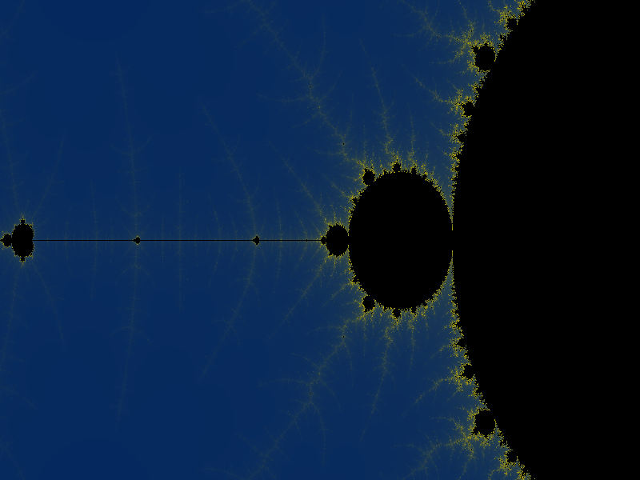

# Mandelbrot loop renderer
This is a simple mandelbrot generator made in python


## Description
This is a live realtime mandelbrot loop renderer built in pygame. It renders the infinite loop at a smooth 120 fps. 

## Setup
1. go to the releases page *[HERE](havent made any releases yet)*
2. download the executable for your specific operating system
3. run it
4. depending on the os the anti virus may block the application from running because its unsigned. if that happens click "more info" and then "run anyway"
5. enjoy!

## Building from source
you may choose to build from source instead of using the provided executables. 

### Prerequisites
- python 3.10 or newer
- pip

### STEPS
1. clone this repo
2. open the repo folder in the terminal
3. install the required dependencies \
```pip install -r requirements.txt```
4. run the project \
```python main.py```

## Controls
- ESC = quit
- F = toggle fps counter

## How is the mandelbrot calculated?
to calculate the fractal you loop through each pixel and for each pixel you convert it into a point on the graph. lets call them (cx, cy).\
\
we also need a second point. lets call it just (x, y). now we loop until we reach maxTurns which determines the quality. in each iteration we use the formulas:

newX = x * x - y * y + cx\
newY = 2 * x * y + cy

we then check if the second point has gone more than 2 units away from the origin. if it has then we break out early and say that this one explodes. 

once that is done we will have a grid of pixels. each pixel has the number of turns it took to escape the loop. if a pixel didnt escape and reached the max number of turns then we paint it black as it didnt escape. 

if it did then we paint it based off the turns it took to escape. in my case i chose blue for the minimum and yellow for the maximum and anything in between is a lerped rgb value.

and from that we get the mesmerising image that is the mandelbrot fractal


## How does it loop?
to make it loop we need to have it zoom into the feigenbaum point which is approximately x = -1.401155189. if we zoom in by approximately 4.669201609102990 it ends up being almost the exact same image as the start. 

so we keep zooming in until we reach that value and loop back around as increasing the zoom requires increasing maxSteps which becomes very resource intensive after a while and tanks the fps.

## How 120 fps?
the render is not actually 120 fps. The actual mandelbrot rendering is very slow. around 20 fps. So. to combat this it runs in a separate thread while the render loop runs at 120 fps. 

in the main loop while waiting for a frame we keep zooming in but this time we zoom into the last rendered frame using pygame which is very fast.

then once another frame is received we reset the zoom and continue. This allows it to be very smooth and can even reach 120 fps easily.